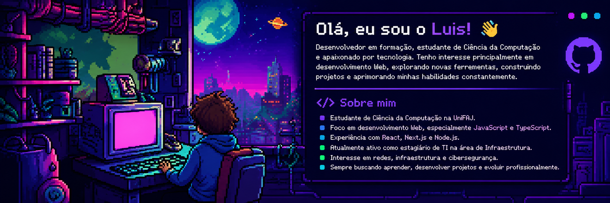

  

 

### 🚀 Tecnologias e ferramentas

**Desenvolvimento Web**

  

**Outras linguagens e tecnologias**

  

**Ferramentas e ambiente**

  

---

### 📊 GitHub Stats

  

---

### 📫 Vamos nos conectar?

  
  
  

---

  <i>"A melhor maneira de aprender é construindo."</i>

